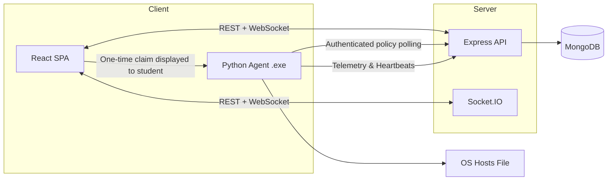

<div align="center">
  <h1>Academia Shield</h1>
  <p><strong>Scheduled lab sessions with device-bound policy enforcement and activity monitoring.</strong></p>
  
  [](https://github.com/SanskarG-20/Academia-Shield/actions)

  [Live Web App](https://academia-shield.vercel.app/) • 
  [Windows preview (unsigned)](https://github.com/SanskarG-20/Academia-Shield/releases)
</div>

<br />

**Academia Shield** is a centralized platform for educators to manage classes and enforce internet policies during exams or lab sessions. Professors define rules and start sessions. A local Python agent applies managed hosts entries for blocked domains, requests a normal close for listed GUI applications, and reports activity during authorized sessions.

---

## ✨ Key Features

- **Real-Time Command Center:** Monitor student presence (Online/Idle/Offline), active applications, and compliance via WebSockets.
- **Desktop Agent:** The Windows executable can auto-start at logon after local installation and enrollment.
- **Device Enrollment:** A signed-in student creates a ten-minute, one-time claim and enters it in the local agent. The agent stores its device credential in the operating-system credential store.
- **Scheduled Policy Enforcement:** The API starts and ends lab sessions from server time; the agent blocks listed domains and requests a normal close for named applications. A recovery task removes expired managed settings even if the main agent exits unexpectedly.
- **AI-Powered Analytics:** Uses Google Gemini to analyze session logs, generate summaries, and flag anomalous behavior.
- **Secure Authentication:** JWT-based sessions with Email OTP verification for students.

## 🏗️ Architecture



## 🚀 Quickstart (Development)

### Prerequisites
- Node.js 18+ and npm
- MongoDB URI
- Python 3.10+ (for local agent dev)

### 1. Setup
```bash
git clone https://github.com/SanskarG-20/Academia-Shield.git
cd Academia-Shield
npm install
```

### 2. Environment Variables
```bash
cp apps/api/.env.example apps/api/.env
cp apps/web/.env.example apps/web/.env
```
*(Populate `MONGO_URI`, `JWT_SECRET`, email delivery settings, and any optional analytics key appropriately. Development-only mock OTP must not be used in production.)*

### 3. Run the Stack
```bash
# Seed initial demo data (demo@professor.com / password123)
npm run seed

# Start the frontend and backend concurrently
npm run dev
```

## 📦 Windows Desktop Installation

The current [nightly release](https://github.com/SanskarG-20/Academia-Shield/releases/tag/nightly) is an **unsigned preview**. Do not install it on student or personal computers. Obtain a trusted Windows code-signing certificate, sign both the agent and installer, and complete controlled Windows device-safety testing before distribution. The release workflow now refuses to publish future unsigned builds. A self-signed certificate does not resolve SmartScreen reputation warnings.

When verified for distribution, `AcademiaShieldSetup.exe` installs the React interface and the Python agent together. The shared API and MongoDB database remain hosted online. The installer needs administrator rights, and the same administrator-capable Windows account must be used to enroll the device. The desktop student sessions page can enroll the included agent directly using a one-time code. The agent begins at the next Windows sign-in.

Uninstalling the desktop app first invokes the agent's safe uninstall, which restores managed hosts/DNS settings. If restoration fails, the installer stops and retains the recovery files. The installer is currently unsigned; Windows may display a publisher warning.

### Standalone Agent Deployment

The Python agent is also available as a standalone Windows executable (`AcademiaShield.exe`) from the same release. GitHub Actions rebuilds both executables when the agent, web interface, or desktop packaging changes on `main`.

### Shared Lab Installation
Run the following in an **Administrator** PowerShell window on each lab PC to download and install the agent as a persistent background service:

```powershell
Invoke-WebRequest -Uri "https://github.com/SanskarG-20/Academia-Shield/releases/download/nightly/AcademiaShield.exe" -OutFile "AcademiaShield.exe"
.\AcademiaShield.exe --install
```

The fresh installation is un-enrolled. The student signs in, joins a professor's batch with its code, opens the student sessions page, and generates an enrollment code. On that same computer, run `AcademiaShield.exe enroll` and enter the code at the prompt. The code expires after ten minutes and can be used once. Start the agent or log in again after enrollment. A student can revoke an enrolled device from the same page. To pair an existing agent with another student, enroll again with the new student's claim; the previous device credential is revoked.

Install and enroll under the **same Windows account**. This version requires that account to have administrator rights for hosts-file enforcement. If Windows elevation uses a different administrator account, its credential store and desktop session are separate; this version does not support that arrangement.

### Agent CLI Commands
- `AcademiaShield.exe --install` : Install logon and once-per-minute recovery tasks.
- `AcademiaShield.exe --install-only` : Install tasks without starting an already-enrolled agent (used by desktop setup).
- `AcademiaShield.exe --uninstall` : Stop enforcement, restore managed settings, and remove scheduled tasks. Files and backups remain for inspection.
- `AcademiaShield.exe --recover` : Check for an expired/missing local policy and restore managed settings when needed.
- `AcademiaShield.exe --status` : View current installation and connection status.
- `AcademiaShield.exe enroll` : Prompt for a student's one-time enrollment code.
- `AcademiaShield.exe logout` : Clear the local credential. Revoke the device in the dashboard when retiring it.

The agent enforces only server-issued policy for its authenticated device. Policies and offline cache entries expire no later than the session's end time. New DNS redirection is disabled; recovery still restores DNS settings left by older agent versions. Application close requests never force-terminate a process, so an app with unsaved work may remain open. The API reconciles session start/end at startup and every five seconds, independent of browser timers. See [implementation specification](docs/device-bound-lab-sessions-spec.md) and [device safety audit](docs/agent-device-safety-audit.md).

See [Windows release safety](docs/windows-release-safety.md) for the signing and controlled-test gates before distribution.

## 🛠️ Tech Stack

- **Frontend:** React 19, TypeScript, Vite, Tailwind CSS, Lucide
- **Backend:** Node.js, Express, Mongoose, Socket.IO
- **Agent:** Python 3.11, PyInstaller
- **Infrastructure:** Vercel (Web), Render (API), MongoDB Atlas (DB), GitHub Actions (CI/CD)
