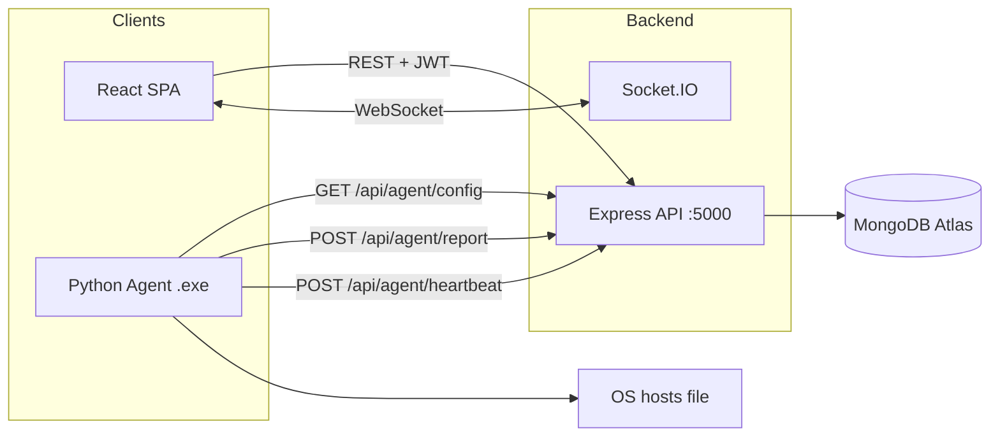

# Academia Shield

🌐 **Live Web Application:** [https://academia-shield.vercel.app/](https://academia-shield.vercel.app/)

**Academia Shield** is an enterprise-grade academic integrity platform for educators. Professors define **rules** (blocked domains and applications), organize **batches** (classes), and run **sessions**. While a session is active, a lightweight **Python agent** on student desktops enforces restrictions by modifying the OS **hosts** file — giving you a production-ready demo of centralized policy with local enforcement, real-time presence monitoring, and live telemetry.

---

## Table of contents

- [Repository layout](#repository-layout)
- [Features](#features)
- [Architecture](#architecture)
- [Tech stack](#tech-stack)
- [Prerequisites](#prerequisites)
- [Getting started](#getting-started)
- [Configuration](#configuration)
- [Running the stack](#running-the-stack)
- [Desktop agent (.exe)](#desktop-agent-exe)
- [Demo account](#demo-account)
- [Single-machine demo flow](#single-machine-demo-flow)
- [Classroom / LAN setup](#classroom--lan-setup)
- [API overview](#api-overview)
- [CI/CD — Automated builds](#cicd--automated-builds)
- [Scripts](#scripts)
- [Troubleshooting](#troubleshooting)
- [Limitations](#limitations)
- [Roadmap](#roadmap)

---

## Repository layout

This repo is an **npm workspaces** monorepo:

```text
.
├── apps/
│   ├── web/                 # React + Vite + TypeScript SPA (@academia-shield/web)
│   │   ├── public/          # Static assets
│   │   ├── src/
│   │   │   ├── components/  # UI components + layout (Sidebar, Navbar, Card, etc.)
│   │   │   ├── pages/       # Route screens (Dashboard, Sessions, Batches, etc.)
│   │   │   ├── lib/         # API client, Socket.IO client
│   │   │   ├── App.tsx      # Router with role-gated routes
│   │   │   ├── main.tsx     # Entry (mounted from index.html)
│   │   │   └── types.ts     # Shared TypeScript interfaces
│   │   ├── index.html       # Tailwind config, design system, global styles
│   │   └── vite.config.ts
│   └── api/                 # Express + MongoDB API (@academia-shield/api)
│       └── src/             # routes, controllers, models, middleware, services
├── services/
│   └── agent/               # Python desktop agent (auto-startup, heartbeats)
│       ├── agent.py          # Main orchestrator with --install/--uninstall CLI
│       ├── config.py         # All environment variables and constants
│       ├── comms/            # HTTP client + Socket.IO client
│       ├── enforcement/      # Hosts-file and DNS enforcement engines
│       └── service/          # Windows Service wrapper
├── .github/
│   └── workflows/
│       └── build-agent.yml  # CI/CD: auto-build .exe on push
├── scripts/
│   └── demo/                # Optional API walkthrough script (demo_flow.py)
├── package.json             # Workspace root
└── README.md
```

---

## Features

### Professor / Admin
- **Dashboard** — Real-time overview of active sessions, enrolled students, engagement charts, anomaly counts, and live session cards.
- **Session Management** — Create, start, end, and delete sessions. Assign rule sets and batches to sessions. View AI-powered session summaries (Gemini).
- **Live Command Center** — Full-screen modal for monitoring active sessions in real-time. Shows per-student presence (Online / Idle / Offline), active application name, engagement score bar, and a live activity feed. WebSocket-powered — updates instantly.
- **Batch / Class Management** — Create classes with unique join codes, manage enrolled students, view batch details.
- **Rules & Policy** — Define blocklist rule sets with blocked domains and applications.
- **Logs & Analytics** — Searchable, filterable log viewer with violation highlighting.
- **Live Monitor** — Global live log stream across all active sessions.

### Student
- **SAP ID + OTP Login** — Email-based OTP verification for secure student authentication.
- **Join Class** — Enter a batch code (with auto-hyphen formatting) to join a class.
- **Session View** — See enrolled sessions, active/upcoming/completed status, and start working.
- **Automated Presence** — Browser-based heartbeats keep the student marked as "Online" in the professor's Live Command Center, even without the desktop agent running.
- **Compliance Status** — Dashboard shows violation count and compliance state.

### Desktop Agent
- **Auto-startup support** — Run `AcademiaShield.exe --install` once; the agent auto-starts at every Windows logon with admin privileges via Windows Task Scheduler.
- **Hosts-file enforcement** — Applies domain blocking rules using OS hosts file with tagged marker comments for clean removal.
- **Real-time heartbeats** — Reports the active foreground window title every 15 seconds to the Live Command Center.
- **Offline resilience** — Caches the last known config to `last_config.json` so blocking persists even if the server is temporarily unreachable.
- **Automatic blocking/unblocking** — Polls the backend every 8-30 seconds; when a professor starts a session, blocking kicks in automatically. When the session ends, the hosts file is restored.

### UI / UX
- **Soothing Indigo design system** — Calmer indigo brand palette, soft rounded corners (rounded-2xl), translucent borders, and custom shadow system (shadow-soft, shadow-lift).
- **Glassmorphism** — Navbar and Sidebar use backdrop-blur-xl with translucent backgrounds for a modern layered feel.
- **Micro-interactions** — Buttons have active:scale press effects, cards lift on hover, modals animate in with scale-in.
- **Collapsible sidebar** — ChatGPT-style toggle with PanelLeft icons. Logo appears in navbar when sidebar is closed.
- **Global search** — Navbar search bar with lazy-loaded dropdown that filters Sessions and Classes/Batches in real-time.
- **Dark mode** — Full dark mode support with deep twilight backgrounds.
- **Custom scrollbars** — Thin, rounded scrollbar thumbs with hover states.
- **Smooth animations** — Custom keyframe animations (fade-in, slide-up, slide-down, scale-in).

### Real-time
- **Socket.IO** — WebSocket-powered live updates for session events, student joins, log entries, and telemetry.
- **Browser heartbeats** — Students on the Dashboard or Sessions page automatically send presence heartbeats every 15 seconds so the Live Command Center shows accurate online status.

### AI
- **Session summaries** — Uses Google Gemini to analyze session logs and generate AI-powered summary reports with violation detection.

---

## Architecture



**Control plane:** The web app communicates with the API using JWTs for authenticated routes and maintains a persistent WebSocket connection via Socket.IO for real-time telemetry.

**Enforcement plane:** The desktop agent polls `GET /api/agent/config` for active policies, applies blocking via the hosts file, and sends heartbeats and activity reports back to the API. The API broadcasts these to connected professors via Socket.IO.

---

## Tech stack

| Layer | Technology |
| --- | --- |
| Frontend | React 19, TypeScript, Vite 6, React Router 7, Tailwind CSS (CDN), Lucide Icons, Recharts |
| Backend | Node.js, Express 4, TypeScript, Mongoose, Helmet, Morgan, CORS |
| Database | MongoDB (Atlas) |
| Auth | JWT (30-day expiry), bcrypt password hashing, email OTP |
| Real-time | Socket.IO (WebSockets) for live telemetry, presence, and session events |
| Agent | Python 3.11, PyInstaller (.exe), Windows Task Scheduler |
| CI/CD | GitHub Actions (auto-build .exe on push) |
| Hosting | Vercel (frontend), Render (API), MongoDB Atlas (database) |

---

## Prerequisites

- **Node.js** 18+ and npm
- **MongoDB** connection string (Atlas or self-hosted)
- **Python 3.10+** (for `services/agent/` and optional `scripts/demo/`)
- **Administrator / root** on student machines when running the agent (hosts file access)
- For student OTP email: SMTP-capable credentials (see `apps/api/.env.example`)

---

## Getting started

### 1. Clone and install

```bash
git clone https://github.com/SanskarG-20/Academia-Shield.git
cd Academia-Shield

npm install
```

### 2. Environment files

Copy the API example and fill in real values:

```bash
cp apps/api/.env.example apps/api/.env
```

For optional Gemini features in the UI, copy the web example (or create `apps/web/.env`):

```bash
cp apps/web/.env.example apps/web/.env
# set VITE_GEMINI_API_KEY=...
```

### 3. Seed demo data

```bash
npm run seed
```

You should see output confirming the demo professor, rules, and a sample session.

### 4. Smoke-test the API

```bash
npm run dev:api
```

Open `http://localhost:5000/api/agent/config` — a typical idle response includes `blocking_active: false` and empty `domains` / `apps` arrays.

---

## Configuration

### Backend (`apps/api/.env`)

| Variable | Purpose |
| --- | --- |
| `MONGO_URI` | MongoDB connection string |
| `JWT_SECRET` | Secret for signing JWTs |
| `PORT` | API port (default `5000`) |
| `CLIENT_URL` | Allowed browser origin context (e.g. `http://localhost:3000`) |
| `EMAIL_*` | Nodemailer transport for student OTP emails |

Never commit `.env`. Use `apps/api/.env.example` as the template.

### Frontend

The frontend API base URL is configured via environment variables in `apps/web/.env.development` and `apps/web/.env.production`. The Tailwind design system (colors, shadows, animations) is configured inline in `apps/web/index.html`.

### Agent (`services/agent/`)

| Variable | Purpose | Default |
| --- | --- | --- |
| `API_URL` | Full backend API URL | `https://academia-shield-api.onrender.com` |
| `STUDENT_SAP_ID` | Student's SAP ID for log attribution | _(empty)_ |
| `POLL_INTERVAL` | Seconds between config polls (5-10) | `8` |
| `ENFORCEMENT_MODE` | `HOSTS` or `DNS` | `HOSTS` |
| `TEST_MODE` | Allow local dev polling | `true` |
| `SOCKET_ENABLED` | Enable Socket.IO push updates | `false` |

---

## Running the stack

| Mode | Command | Notes |
| --- | --- | --- |
| API + Web (one terminal) | `npm run dev` | Runs API and Vite together via `concurrently` |
| API only | `npm run dev:api` | Default `PORT` from `apps/api/.env` (5000) |
| Web only | `npm run dev:web` | Vite — `apps/web/vite.config.ts`, port 3000 |
| Agent (Python) | `python services/agent/agent.py` | Use `sudo` (macOS/Linux) or elevated shell (Windows) |
| Agent (.exe) | `AcademiaShield.exe` | Download from [Releases](https://github.com/SanskarG-20/Academia-Shield/releases) |

---

## Desktop agent (.exe)

The Python agent is compiled into a standalone Windows `.exe` via GitHub Actions. No Python installation needed on student machines.

### One-line download (PowerShell)

```powershell
Invoke-WebRequest -Uri "https://github.com/SanskarG-20/Academia-Shield/releases/download/nightly/AcademiaShield.exe" -OutFile "AcademiaShield.exe"
```

### Install with auto-startup

Run in an **Administrator** terminal:

```powershell
.\AcademiaShield.exe --install
```

This will:
1. Prompt for the student's **SAP ID**
2. Copy the agent to `C:\ProgramData\AcademiaShield\`
3. Register a Windows Task Scheduler task that runs at every logon with admin privileges
4. Start the agent immediately

**After installation, zero interaction is needed.** The agent silently starts at every Windows logon. When a professor starts a session, blocking kicks in automatically.

### CLI commands

| Command | Description |
| --- | --- |
| `AcademiaShield.exe` | Run the agent manually |
| `AcademiaShield.exe --install` | Install + auto-start on boot |
| `AcademiaShield.exe --uninstall` | Remove auto-start and clean up |
| `AcademiaShield.exe --status` | Check installation status |
| `AcademiaShield.exe --help` | Show all commands |

### How it works

1. The agent polls `GET /api/agent/config` every 8–30 seconds
2. If an active session exists with blocked domains, the agent writes entries to the OS hosts file
3. Every 15 seconds, it reports the active foreground window title as a heartbeat
4. When the session ends, the hosts file is restored to its original state
5. If the server is unreachable, the last known config is cached and enforced

---

## Demo account

After `npm run seed`:

- **Professor Email:** `demo@professor.com`
- **Password:** `password123`
- **Student SAP ID:** `600000001234`
- **Student OTP (when `STUDENT_OTP_MODE=mock`):** `123456`

---

## Single-machine demo flow

1. Start backend + frontend:
   ```bash
   npm run dev
   ```

2. Seed demo records:
   ```bash
   npm run seed
   ```

3. Open professor login in a **normal browser window** and sign in with `demo@professor.com / password123`.
4. Open student login in an **Incognito/Private window** and sign in with SAP ID `600000001234` and OTP `123456`.
5. Student joins class code `CE-SY-2024`.
6. Professor creates or opens a session and clicks **Start** so status becomes `Active`.
7. Run the local agent:
   ```bash
   python services/agent/agent.py
   ```
8. Open `youtube.com` or `instagram.com` to verify blocking, then end the session to verify unblocking.

**Notes:**
- `TEST_MODE=true` in `apps/api/.env` allows local agent polling without strict device allowlisting.
- Use separate browser contexts (normal + incognito) to keep professor and student JWT/localStorage independent.
- The student's browser automatically sends presence heartbeats — you'll see them as "Online" in the Live Command Center even without the desktop agent.

---

## Classroom / LAN setup

1. On the professor machine, note the hotspot or LAN IPv4 address (`ipconfig` on Windows).
2. Set `apps/web/.env.development` → `VITE_API_URL` to `http://<that-ip>:5000`.
3. Set `services/agent/.env.development` → `API_URL` to `http://<that-ip>:5000`.
4. Ensure the API is reachable from student devices (firewall rules as needed).

---

## API overview

Base path: `/api`

| Area | Prefix | Auth |
| --- | --- | --- |
| Authentication | `/api/auth` | Mixed (login, register, OTP) |
| Batches | `/api/batches` | JWT |
| Sessions | `/api/sessions` | JWT |
| Rules | `/api/rules` | JWT |
| Logs | `/api/logs` | JWT |
| Agent config | `/api/agent/config` | **None** (by design) |
| Agent report | `/api/agent/report` | **None** |
| Agent heartbeat | `/api/agent/heartbeat` | **None** |

Health: `GET /` on the API root returns a short status string.

---

## CI/CD — Automated builds

A GitHub Actions workflow (`.github/workflows/build-agent.yml`) automatically builds the Python agent into a standalone `.exe` whenever changes are pushed to `services/agent/` on the `main` branch.

### How it works

1. Push changes to `services/agent/` → GitHub Actions triggers
2. A Windows VM installs Python, dependencies, and PyInstaller
3. The agent is compiled into `AcademiaShield.exe`
4. The `.exe` is published to the **Nightly Release** on GitHub

### To update the .exe after code changes

```bash
git add . && git commit -m "your message" && git push
```

That's it. GitHub builds and publishes a fresh `.exe` automatically (~2 minutes).

### To manually trigger a build

Go to **Actions** → **Build Agent (.exe)** → **Run workflow** on the GitHub UI.

---

## Scripts

### Workspace root (`package.json`)

| Script | Description |
| --- | --- |
| `npm run dev` | API + web in parallel |
| `npm run dev:api` | API only (`@academia-shield/api`) |
| `npm run dev:web` | Vite dev server (`@academia-shield/web`) |
| `npm run build` | Build web, then compile API to `apps/api/dist/` |
| `npm run build:web` / `npm run build:api` | Individual package builds |
| `npm run preview` | Preview Vite production build |
| `npm run seed` | Run `seedDemo.ts` in the API package |
| `npm run start:api` | Run compiled API (`node apps/api/dist/server.js`) |

### Per package

| Location | Typical commands |
| --- | --- |
| `apps/web` | `npm run dev`, `npm run build`, `npm run preview` |
| `apps/api` | `npm run dev`, `npm run build`, `npm start`, `npm run seed` |

---

## Troubleshooting

| Symptom | What to check |
| --- | --- |
| Agent `PermissionError` | Run elevated (Administrator / `sudo`). |
| Agent cannot reach server | `API_URL` in `.env.production`, firewall, and that the API is bound to `0.0.0.0`. |
| Browser errors / failed fetches | `VITE_API_URL` must match the API URL students and professors use. |
| MongoDB errors | `MONGO_URI`, Atlas IP allowlist, and cluster user permissions. |
| Port already in use | Change `PORT` in `apps/api/.env` and update clients accordingly. |
| Student OTP email fails in local demo | Set `STUDENT_OTP_MODE=mock` and use `MOCK_STUDENT_OTP` from `apps/api/.env`. |
| Professor/student sessions collide | Use normal window for professor and Incognito/Private window for student. |
| Session Active but agent shows standby | Ensure the session was started from the UI and check `GET /api/agent/config` for `active: true`. |
| Blocked domain still opens | Flush DNS (`ipconfig /flushdns` on Windows) and retry in a fresh tab. |
| Student shows OFFLINE in Live Monitor | Ensure the student has the Sessions or Dashboard page open (browser heartbeats), or the desktop agent running. |
| `.exe` build fails on GitHub Actions | Check the Actions tab for build logs. Ensure `services/agent/requirements.txt` is up to date. |
| `--install` fails | Run the `.exe` from an Administrator terminal. |

---

## Limitations

- **Hosts-based blocking** requires local admin rights and can be reversed by a user with sufficient privileges.
- **Polling latency** means enforcement updates are not instantaneous (8–30 second delay).
- **Agent endpoints** (`/api/agent/*`) are unauthenticated by design; protect at network layer for production.
- **Browser heartbeats** only work while the student has the web app open in a tab.
- **Auto-startup** currently supports Windows only (via Task Scheduler).

---

## Roadmap

- [ ] DNS-level enforcement to reduce reliance on local admin.
- [ ] Browser extension for stronger application-level controls.
- [ ] Push-based agent updates via Socket.IO to replace polling.
- [ ] Deeper analytics and AI-assisted anomaly detection.
- [ ] macOS / Linux auto-startup support (launchd / systemd).
- [ ] Auto-update mechanism for the desktop agent.

---

## Contributing

Issues and pull requests are welcome. Please keep changes focused, match existing code style, and avoid committing secrets or local `.env` files.

---

## License

The workspace root `package.json` is **private**. Add a root `LICENSE` file if you intend to open-source the project.
