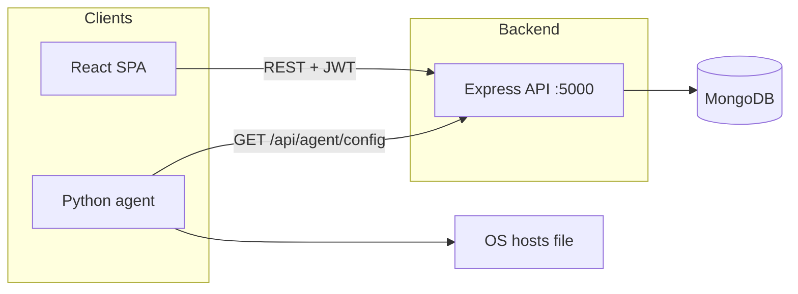

# Academia Shield

**Academia Shield** is a classroom session and policy platform for educators. Professors define **rules** (domains and applications), organize **batches**, and run **sessions**. While a session is active, a lightweight **Python agent** on student machines polls the API and applies restrictions by updating the OS **hosts** file—giving you a practical demo of centralized policy with local enforcement.

---

## Table of contents

- [Features](#features)
- [Architecture](#architecture)
- [Tech stack](#tech-stack)
- [Prerequisites](#prerequisites)
- [Getting started](#getting-started)
- [Configuration](#configuration)
- [Running the stack](#running-the-stack)
- [Demo account](#demo-account)
- [Classroom / LAN setup](#classroom--lan-setup)
- [Python agent](#python-agent)
- [API overview](#api-overview)
- [Scripts](#scripts)
- [Troubleshooting](#troubleshooting)
- [Limitations](#limitations)
- [Roadmap](#roadmap)

---

## Features

- **Professor dashboard** — sessions, rules, batches, logs, and live monitoring (role-gated in the UI).
- **Student flows** — SAP ID + OTP email verification, profile and batch join paths.
- **Policy engine (server)** — active sessions within their time window drive merged block lists for the agent.
- **Desktop agent** — cross-platform Python (stdlib), configurable poll interval, hosts-file apply/remove with a tagged block section.
- **Optional AI** — session summaries can use the Google GenAI SDK when `GEMINI_API_KEY` is set in the frontend environment (see [Vite env](https://vitejs.dev/guide/env-and-mode.html)).

---

## Architecture



**Control plane:** the web app talks to the API with JWTs for authenticated routes.  
**Enforcement plane:** the agent calls **unauthenticated** `GET /api/agent/config` on a timer, then adds or removes `0.0.0.0` (or equivalent) entries for listed domains.

---

## Tech stack

| Layer | Technology |
| --- | --- |
| Frontend | React 19, TypeScript, Vite 6, React Router 7, Tailwind CSS (CDN), Lucide, Recharts |
| Backend | Node.js, Express 4, TypeScript, Mongoose, Helmet, Morgan, CORS |
| Database | MongoDB (e.g. Atlas) |
| Auth | JWT (30-day expiry), bcrypt password hashing |
| Real-time | Socket.IO wired on the server (push-based blocking is a roadmap item) |
| Agent | Python 3, standard library only |

---

## Prerequisites

- **Node.js** 18+ and npm
- **MongoDB** connection string (Atlas or self-hosted)
- **Python 3** (for `agent/` and optional `demo/`)
- **Administrator / root** on student machines when running the agent (hosts file access)
- For student OTP email: SMTP-capable credentials (see `.env.example`)

---

## Getting started

### 1. Clone and install

```bash
git clone https://github.com/SanskarG-20/IPD---Academia-Shield.git
cd IPD---Academia-Shield

npm install
cd server && npm install && cd ..
```

### 2. Environment files

Copy the server example and fill in real values:

```bash
cp server/.env.example server/.env
```

For optional Gemini features in the UI, create a root `.env` (Vite):

```env
GEMINI_API_KEY=your_key_here
```

### 3. Seed demo data

```bash
cd server
npm run seed
```

You should see output confirming the demo professor, rules, and a sample session.

### 4. Smoke-test the API

```bash
cd server
npm run dev
```

Open `http://localhost:5000/api/agent/config` — a typical idle response includes `blocking_active: false` and empty `domains` / `apps` arrays.

---

## Configuration

### Backend (`server/.env`)

| Variable | Purpose |
| --- | --- |
| `MONGO_URI` | MongoDB connection string |
| `JWT_SECRET` | Secret for signing JWTs |
| `PORT` | API port (default `5000`) |
| `CLIENT_URL` | Allowed browser origin context (e.g. `http://localhost:3000`) |
| `EMAIL_*` | Nodemailer transport for student OTP emails |

Never commit `.env`. Use `server/.env.example` as the template.

### Frontend API base URL

In **`api.ts`**, set `BASE_URL` to your API origin:

- Local: `http://localhost:5000`
- LAN / hotspot: `http://<professor-machine-ip>:5000`

### Agent

In **`agent/agent.py`**, set `SERVER_IP` (and optionally `SERVER_PORT`) to match the machine running the API.

---

## Running the stack

| Terminal | Command | Notes |
| --- | --- | --- |
| 1 — API | `cd server && npm run dev` | Listens on `PORT` (default 5000) |
| 2 — Web | `npm run dev` | Vite dev server (see `vite.config.ts`, default port 3000) |
| 3 — Agent | `python agent/agent.py` | Use `sudo` (macOS/Linux) or elevated shell (Windows) |

Optional:

```bash
python demo/demo_flow.py
```

---

## Demo account

After `npm run seed` in `server/`:

- **Email:** `dr.sharma@university.edu`  
- **Password:** `demo1234`

---

## Classroom / LAN setup

1. On the professor machine, note the hotspot or LAN IPv4 address (Windows: `ipconfig`; macOS: `ifconfig` / `ipconfig getifaddr en0`).
2. Set **`api.ts`** → `BASE_URL` to `http://<that-ip>:5000`.
3. Set **`agent/agent.py`** → `SERVER_IP` to the same IP.
4. Ensure the API is reachable from student devices (firewall rules as needed).

---

## Python agent

- **Poll interval:** 30 seconds by default (`POLL_INTERVAL` in `agent.py`).
- **Cache:** writes `last_config.json` when the server is unreachable so the last known policy can still be applied conservatively (see agent logs).
- **Hosts file:** uses a marker comment (e.g. `# academia-shield`) so blocks can be removed cleanly when sessions end.

---

## API overview

Base path: `/api`

| Area | Prefix | Auth |
| --- | --- | --- |
| Authentication | `/api/auth` | Mixed (login vs OTP) |
| Batches | `/api/batches` | JWT |
| Sessions | `/api/sessions` | JWT |
| Rules | `/api/rules` | JWT |
| Logs | `/api/logs` | JWT |
| Agent config | `/api/agent` | **None** (by design; protect at network layer if needed) |

Health: `GET /` on the API root returns a short status string.

---

## Scripts

### Frontend (repository root)

| Script | Description |
| --- | --- |
| `npm run dev` | Start Vite dev server |
| `npm run build` | Production build to `dist/` |
| `npm run preview` | Preview production build |

### Backend (`server/`)

| Script | Description |
| --- | --- |
| `npm run dev` | Run API with `ts-node-dev` (watch) |
| `npm run build` | Compile TypeScript to `server/dist/` |
| `npm start` | Run compiled `dist/server.js` |
| `npm run seed` | Populate demo data via `seedDemo.ts` |

---

## Troubleshooting

| Symptom | What to check |
| --- | --- |
| Agent `PermissionError` | Run elevated (Administrator / `sudo`). |
| Agent cannot reach server | `SERVER_IP`, firewall, and that the API is bound to `0.0.0.0` if accessing from other hosts. |
| Browser errors / failed fetches | `BASE_URL` in `api.ts` must match the API URL students and professors use. |
| MongoDB errors | `MONGO_URI`, Atlas IP allowlist, and cluster user permissions. |
| Port already in use | Change `PORT` in `server/.env` and update clients accordingly. |

---

## Limitations

- **Hosts-based blocking** requires local admin rights and can be reversed by a user with sufficient privileges.
- **Polling latency** means enforcement updates are not instantaneous compared to a push model.
- **Agent endpoint** is public; treat network placement and segmentation accordingly for production.

---

## Roadmap

- DNS-level enforcement to reduce reliance on local admin.
- Push-based updates (e.g. WebSocket) to replace or complement polling.
- Browser extension and stronger application-level controls.
- Deeper analytics and optional AI-assisted anomaly detection.

---

## Contributing

Issues and pull requests are welcome. Please keep changes focused, match existing code style, and avoid committing secrets or local `.env` files.

---

## License

This repository is marked **private** in `package.json`. Add a `LICENSE` file at the root if you intend to open-source the project.
