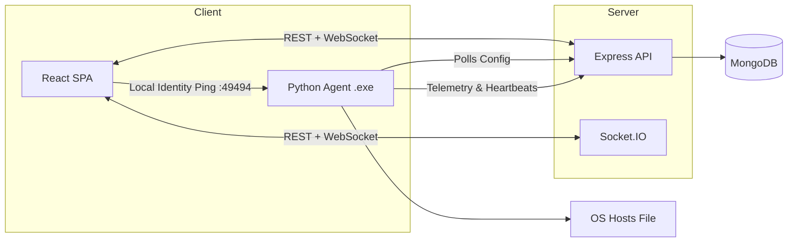

<div align="center">
  <h1>🛡️ Academia Shield</h1>
  <p><strong>Enterprise-grade academic integrity and classroom session management platform.</strong></p>
  
  [](https://github.com/SanskarG-20/Academia-Shield/actions)
  [](https://opensource.org/licenses/MIT)

  [Live Web App](https://academia-shield.vercel.app/) • 
  [Download Agent](https://github.com/SanskarG-20/Academia-Shield/releases)
</div>

<br />

**Academia Shield** is a centralized platform for educators to manage classes and enforce internet policies during exams or lab sessions. Professors define rules (blocked domains/applications) and start sessions. A lightweight, auto-starting Python agent on student machines enforces these restrictions in real-time via OS-level controls.

---

## ✨ Key Features

- **Real-Time Command Center:** Monitor student presence (Online/Idle/Offline), active applications, and compliance via WebSockets.
- **Zero-Touch Desktop Agent:** Standalone Windows `.exe` that installs as a background service and auto-starts on boot. No Python required on student machines.
- **Seamless Lab Pairing:** Perfect for shared computer labs. The background agent dynamically pairs with the current student the exact moment they log into the Web App.
- **Dynamic Policy Enforcement:** Modifies OS network settings (hosts/DNS) automatically when a session starts, and restores them when it ends.
- **AI-Powered Analytics:** Uses Google Gemini to analyze session logs, generate summaries, and flag anomalous behavior.
- **Secure Authentication:** JWT-based sessions with Email OTP verification for students.

## 🏗️ Architecture



## 🚀 Quickstart (Development)

### Prerequisites
- Node.js 18+ and npm
- MongoDB URI
- Python 3.10+ (for local agent dev)

### 1. Setup
```bash
git clone https://github.com/SanskarG-20/Academia-Shield.git
cd Academia-Shield
npm install
```

### 2. Environment Variables
```bash
cp apps/api/.env.example apps/api/.env
cp apps/web/.env.example apps/web/.env
```
*(Populate `MONGO_URI`, `JWT_SECRET`, and `VITE_GEMINI_API_KEY` appropriately)*

### 3. Run the Stack
```bash
# Seed initial demo data (demo@professor.com / password123)
npm run seed

# Start the frontend and backend concurrently
npm run dev
```

## 📦 Desktop Agent Deployment

The Python agent is automatically compiled into a standalone Windows executable (`AcademiaShield.exe`) via GitHub Actions CI/CD on every push.

### Shared Lab Installation
Run the following in an **Administrator** PowerShell window on each lab PC to download and install the agent as a persistent background service:

```powershell
Invoke-WebRequest -Uri "https://github.com/SanskarG-20/Academia-Shield/releases/download/nightly/AcademiaShield.exe" -OutFile "AcademiaShield.exe"
.\AcademiaShield.exe --install
```

*Note: You do not need to provide an SAP ID during installation. The agent will automatically detect who is sitting at the PC the moment they log into the Academia Shield website.*

### Agent CLI Commands
- `AcademiaShield.exe --install` : Install as a Windows scheduled task (auto-starts on boot).
- `AcademiaShield.exe --uninstall` : Remove background service and clean up files.
- `AcademiaShield.exe --status` : View current installation and connection status.

## 🛠️ Tech Stack

- **Frontend:** React 19, TypeScript, Vite, Tailwind CSS, Lucide
- **Backend:** Node.js, Express, Mongoose, Socket.IO
- **Agent:** Python 3.11, PyInstaller
- **Infrastructure:** Vercel (Web), Render (API), MongoDB Atlas (DB), GitHub Actions (CI/CD)

## 📄 License

This project is licensed under the MIT License.
