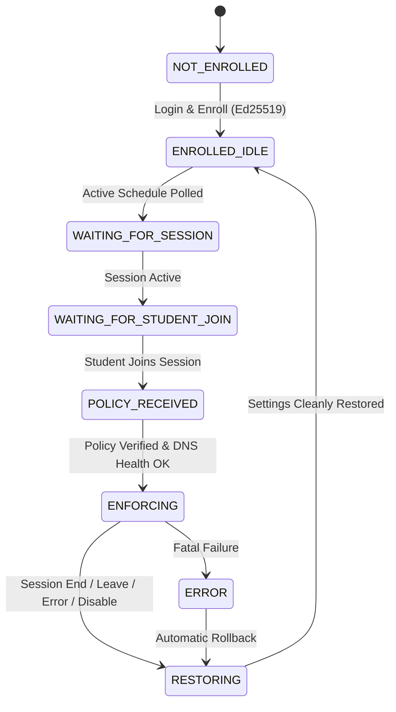

# Academia Shield Local Agent Architecture

## Overview
The **Academia Shield Local Agent** is a cross-platform (Windows and macOS) endpoint security companion designed for academic honesty and examination integrity. It follows strict principles of safety, transparency, consent, and auditability.

```
                    +------------------------------------+
                    |   Academia Shield Cloud Backend    |
                    |   (FastAPI + PostgreSQL + Ed25519) |
                    +------------------------------------+
                                      ^
                                      | HTTPS (JWT + Ed25519 signatures)
                                      v
+-----------------------------------------------------------------------------+
|                           ACADEMIA SHIELD AGENT                             |
|                                                                             |
|  +-----------------------------------------------------------------------+  |
|  |                          AGENT CORE (Python)                          |  |
|  |                                                                       |  |
|  |  +------------------+  +------------------+  +---------------------+  |  |
|  |  |  Auth / Tokens   |  | Device Enrollment|  |  8-State Machine    |  |  |
|  |  | (Ed25519 Keypair)|  | (Hardware Probe) |  | (Strict Transitions)|  |  |
|  |  +------------------+  +------------------+  +---------------------+  |  |
|  |                                                                       |  |
|  |  +------------------+  +------------------+  +---------------------+  |  |
|  |  |  Policy Engine   |  | Telemetry Queue  |  |  Local Storage / DB |  |  |
|  |  |(Clock-Skew Guard)|  |  (Bounded FIFO)  |  | (Cache & Audit Log) |  |  |
|  |  +------------------+  +------------------+  +---------------------+  |  |
|  +-----------------------------------------------------------------------+  |
|                                     |                                       |
|                  +------------------+------------------+                    |
|                  |                                     |                    |
|                  v                                     v                    |
|  +-------------------------------+   +-------------------------------+      |
|  |    Windows Platform Adapter   |   |     macOS Platform Adapter    |      |
|  |                               |   |                               |      |
|  | - DPAPI / Credential Manager  |   | - macOS Keychain Services     |      |
|  | - psutil App Monitor (Safe)   |   | - Audit/Warn Process Monitor  |      |
|  | - Port 5353 DNS Proxy         |   | - networksetup / scutil DNS   |      |
|  | - Netsh DNS Backup & Revert   |   | - Network Extension Swift     |      |
|  | - WDAC / USB Compliance Audit |   | - MDM Profile Audit           |      |
|  | - Authenticode Signed MSI/EXE |   | - Developer ID Signed / Notary|      |
|  +-------------------------------+   +-------------------------------+      |
+-----------------------------------------------------------------------------+
```

---

## 8-State Lifecycle State Machine

The agent operates as a deterministic Finite State Machine:



### State Definitions:
1. **NOT_ENROLLED**: Fresh installation. No student credentials or device keys exist.
2. **ENROLLED_IDLE**: Student authenticated; Ed25519 device keypair generated and public key registered.
3. **WAITING_FOR_SESSION**: Agent is polling for scheduled or active academic sessions.
4. **WAITING_FOR_STUDENT_JOIN**: An active session exists, but enforcement remains dormant until the student explicitly consents and joins.
5. **POLICY_RECEIVED**: Signed policy received, signature verified, and clock skew validated (<=120s).
6. **ENFORCING**: Active session enforcement: DNS proxy redirection active and process monitor running.
7. **RESTORING**: Mandatory teardown state: Restores original network DNS configuration, stops process monitoring, logs audit trail, and emits `policy_restored` telemetry.
8. **ERROR**: Safe fault state. Automatically triggers restoration callback to prevent leaving system in a restricted state.

---

## Platform Abstraction Layer

All platform adapters implement clean interfaces returning structured status enums:
- `supported`: Capability is available and operational.
- `unavailable`: Feature is unavailable on the host OS.
- `requires_user_approval`: Feature requires explicit administrator or UAC elevation.
- `requires_mdm`: Capability requires institutional Mobile Device Management profile (e.g. Apple Network Extension).
- `active`: Currently running and actively enforcing.
- `error`: Diagnostic error during execution.
